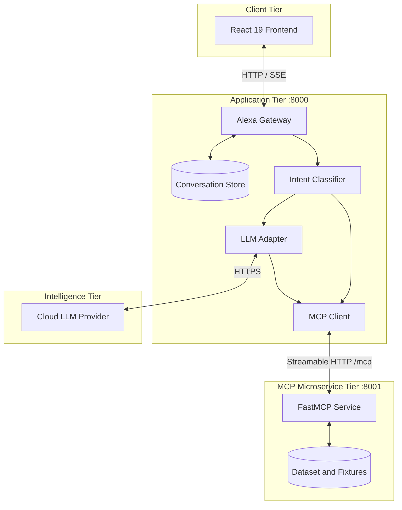
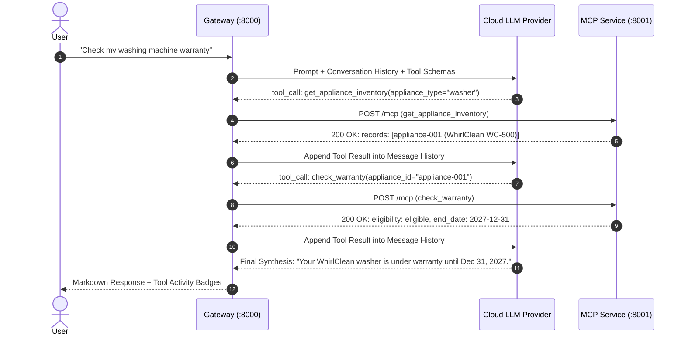

# Alexa: Conversational Assistant & Appliance Intelligence Platform

An open, extensible, and provider-neutral conversational platform that combines natural, human-like dialogue with specialized household appliance diagnostics, Model Context Protocol (MCP) tool execution, and safe, evidence-aware synthesis.

---

## Table of Contents

- [Section A: Project Introduction](#section-a-project-introduction)
  - [1. Project Overview](#1-project-overview)
  - [2. Implemented Features](#2-implemented-features)
  - [3. Current Implementation Status](#3-current-implementation-status)
- [Section B: Prerequisites and Environment Setup](#section-b-prerequisites-and-environment-setup)
  - [4. System Requirements](#4-system-requirements)
  - [5. Clone the Repository](#5-clone-the-repository)
  - [6. Python Environment Setup](#6-python-environment-setup)
  - [7. Frontend Setup](#7-frontend-setup)
  - [8. Environment Configuration](#8-environment-configuration)
  - [9. Port and Networking Configuration](#9-port-and-networking-configuration)
- [Section C: Running the Application](#section-c-running-the-application)
  - [10. Recommended Startup Procedure](#10-recommended-startup-procedure)
  - [11. Running Individual Components](#11-running-individual-components)
  - [12. First-Run Verification Checklist](#12-first-run-verification-checklist)
- [Section D: Architecture and Design Choices](#section-d-architecture-and-design-choices)
  - [13. High-Level Architecture](#13-high-level-architecture)
  - [14. Request Lifecycle](#14-request-lifecycle)
  - [15. Design Decisions and Rationale](#15-design-decisions-and-rationale)
- [Section E: MCP Architecture and Tool Execution](#section-e-mcp-architecture-and-tool-execution)
  - [16. Role of MCP in Alexa](#16-role-of-mcp-in-alexa)
  - [17. MCP Transport and Protocol Conformance](#17-mcp-transport-and-protocol-conformance)
  - [18. Tool Catalogue](#18-tool-catalogue)
  - [19. Concrete Tool Execution Example](#19-concrete-tool-execution-example)
- [Section F: LLM Orchestration, Recursion, and Control Flow](#section-f-llm-orchestration-recursion-and-control-flow)
  - [20. The LLM/Tool Loop](#20-the-llmtool-loop)
  - [21. Bounded Iteration vs. Uncontrolled Recursion](#21-bounded-iteration-vs-uncontrolled-recursion)
  - [22. Conversation State and Multi-Turn Workflows](#22-conversation-state-and-multi-turn-workflows)
  - [23. Intent-Aware Routing and Dual-Mode Operation](#23-intent-aware-routing-and-dual-mode-operation)
- [Section G: Data, Synthetic Records, and Provenance](#section-g-data-synthetic-records-and-provenance)
  - [24. Data Architecture](#24-data-architecture)
  - [25. The 117-Record Synthetic Appliance Dataset](#25-the-117-record-synthetic-appliance-dataset)
  - [26. Missing-Model Synthesis and Uncertainty Labeling](#26-missing-model-synthesis-and-uncertainty-labeling)
  - [27. Contributor Guide: Adding New Tools and Datasets](#27-contributor-guide-adding-new-tools-and-datasets)
- [Section H: Frontend, Streaming, and Observability](#section-h-frontend-streaming-and-observability)
  - [28. Frontend Architecture & Markdown Rendering](#28-frontend-architecture--markdown-rendering)
  - [29. Event Lifecycle & Server-Sent Events (SSE)](#29-event-lifecycle--server-sent-events-sse)
  - [30. Logging, Tracing, and Correlation IDs](#30-logging-tracing-and-correlation-ids)
- [Section I: Testing and Verification](#section-i-testing-and-verification)
  - [31. Test Suite Architecture](#31-test-suite-architecture)
  - [32. Executing Automated Tests](#32-executing-automated-tests)
  - [33. Acceptance and Manual Verification Plan](#33-acceptance-and-manual-verification-plan)
- [Section J: Engineering Challenges and Lessons Learned](#section-j-engineering-challenges-and-lessons-learned)
  - [34. Engineering Challenges Overcome](#34-engineering-challenges-overcome)
  - [35. Concrete Engineering Principles](#35-concrete-engineering-principles)
- [Section K: Troubleshooting Guide](#section-k-troubleshooting-guide)
  - [36. Common Setup and Runtime Issues](#36-common-setup-and-runtime-issues)
  - [37. Systematic Diagnostic Workflow](#37-systematic-diagnostic-workflow)
- [Section L: Security, Safety, Limitations, and Roadmap](#section-l-security-safety-limitations-and-roadmap)
  - [38. Security Controls and Safety Governance](#38-security-controls-and-safety-governance)
  - [39. Known Limitations](#39-known-limitations)
  - [40. Future Roadmap](#40-future-roadmap)
- [Section M: Repository Reference and Contribution Guide](#section-m-repository-reference-and-contribution-guide)
  - [41. Repository Directory Structure](#41-repository-directory-structure)
  - [42. Contribution Guidelines](#42-contribution-guidelines)
  - [43. Final Quick-Start Cheat Sheet](#43-final-quick-start-cheat-sheet)

---

# Section A: Project Introduction

### 1. Project Overview

**Alexa** is a dual-capability conversational intelligence platform. Rather than forcing users into a rigid troubleshooting tree or functioning as an unconstrained generative chatbot prone to hallucinating appliance repair steps, Alexa bridges the gap between:

1. **Natural, Context-Aware Conversation:** Free-form greetings, small talk, clarifications, jokes, capability overviews, and contextual follow-ups without unwarranted tool executions or rigid questionnaires.
2. **Deterministic Appliance Support:** Robust household inventory resolution, exact-model troubleshooting, warranty verification, service-slot discovery, and HMAC-authenticated service request dispatching over the standardized **Model Context Protocol (MCP)**.

Traditional AI chatbots often hallucinate appliance error codes, cite non-existent user manuals, or immediately prompt the user with long appliance questionnaires when all the user said was `"Helloo"`. Alexa solves this by decoupling **conversational intent understanding** from **domain execution barriers**, grounding physical troubleshooting in verified manufacturer evidence and synthetic ownership records.

> **Disclaimer:** This project is an independent reference architecture demonstrating conversational intelligence, MCP integration, and deterministic tool safety. It is not an official Amazon Alexa product, Alexa+ integration, or certified Alexa skill.

### 2. Implemented Features

- **Intent-Aware Conversational Routing:** Classifies user messages into conversational intents (`greeting`, `smalltalk`, `joke`, `gratitude`, `capabilities`, `history`) and appliance intents (`troubleshooting`, `warranty`, `service`, `case_status`).
- **Zero-Tool Greetings:** Everyday greetings like `Helloo` or `How are you?` receive natural, concise replies without invoking backend inventory lookups.
- **Provider-Neutral Cloud LLM Gateway:** Adapts to OpenAI-compatible Chat Completions endpoints (e.g., OpenAI, NVIDIA NIM, OpenRouter, self-hosted gateways) with real-time SSE streaming.
- **Resilient Deterministic Fallback:** Automatically degrades to deterministic local MCP execution if the cloud LLM is offline, unconfigured, or returns an HTTP 403/timeout, preventing user dead-ends.
- **Standardized MCP Tool Execution:** Communicates with an isolated appliance microservice over **Streamable HTTP** conforming to MCP specification revision `2026-07-28`.
- **Household-Scoped Inventory Lookup:** Resolves owned appliances against household records (`demo-household`), clearly distinguished from broad catalogue product searches.
- **Missing-Model Evidence Synthesis:** When an exact appliance model is not in the database, Alexa synthesizes safe, generic diagnostic checks (power, ventilation, seals) with explicit uncertainty labeling (`generic_appliance_knowledge`), requesting missing model details only when helpful.
- **HMAC-Protected Action Confirmation:** Consequential actions (e.g., booking a service technician) cannot be executed by the LLM alone; they require a cryptographically signed confirmation token (`MCP_CONFIRMATION_SECRET`) bound to the exact appliance, issue, and service slot.
- **Rich Markdown Rendering:** Web interface renders formatted markdown including bold text, bulleted lists, numbered procedures, syntax-highlighted code blocks, and tables using `marked` and `DOMPurify`.
- **117-Record Synthetic Appliance Dataset:** Validated dataset covering 10 major home appliance categories with relational warranty and troubleshooting fixtures.

### 3. Current Implementation Status

| Capability | Implementation Status | Evidence / Verification |
|---|---|---|
| **Conversational Greetings** | Verified Implemented | Automated tests in `test_alexa_conversational_intelligence.py`; 0 tool calls executed on `"Helloo"`. |
| **MCP Protocol Conformance** | Verified Implemented | Protocol `2026-07-28`, Streamable HTTP, verified by 11 tests in `test_mcp_protocol_conformance.py`. |
| **Deterministic Fallback** | Verified Implemented | 21 integration tests in `test_mcp_fallback_integration.py` verify full operation without active LLM API keys. |
| **Missing Model Synthesis** | Verified Implemented | `llm/synthesis.py` module with formal evidence categories and uncertainty labeling. |
| **117 Synthetic Records** | Verified Implemented | `mcp/data/appliances.json` (117 records, 10 categories, validated by automated tests). |
| **Action Confirmation Barrier** | Verified Implemented | HMAC SHA-256 tokens required in `mcp/main.py::create_service_request`. |
| **Markdown Chat Rendering** | Verified Implemented | `webapp/src/frontend/components/conversation/MarkdownContent.tsx` using `marked` + `DOMPurify`. |
| **Process Launcher** | Verified Implemented | `main.py` launches MCP (`:8001`), Backend (`:8000`), and Frontend (`:5173`) with graceful shutdown. |

---

# Section B: Prerequisites and Environment Setup

### 4. System Requirements

- **Operating System:** Windows 10/11 (PowerShell 7+ or Windows PowerShell 5.1), macOS (12+), or Ubuntu/Debian Linux (20.04+). No WSL required on Windows.
- **Python:** Version `3.12` or higher (verified with Python 3.12.3 / 3.12.8).
- **Node.js:** Version `18.18+` or `20.x+` (verified with Node.js v20.x).
- **Package Manager:** `npm` (included with Node.js) or `pnpm`.
- **Network Access:** Localhost loopback permissions (`127.0.0.1`) and outbound HTTPS if using a remote cloud LLM provider.
- **LLM Credentials:** Optional for local deterministic mode; an OpenAI-compatible API key (OpenAI, NVIDIA NIM, Groq, etc.) for live generative mode.

### 5. Clone the Repository

Clone the project repository to your local drive and navigate into the root directory:

```bash
git clone <repository-url> alexa-appliance-platform
cd alexa-appliance-platform
```

> **Working Directory:** Unless explicitly stated otherwise, root commands are run from the top-level `alexa-appliance-platform` directory.

### 6. Python Environment Setup

The application separates the **LLM Gateway** (`llm/`) and the **MCP Microservice** (`mcp/`) into modular components. For local execution, a dedicated virtual environment with `mcp[cli]==2.0.0` and dependencies is used.

#### Virtual Environment Creation (PowerShell)

```powershell
# From the repository root
python -m venv llm/.venv
llm\.venv\Scripts\python.exe -m pip install --upgrade pip
llm\.venv\Scripts\python.exe -m pip install "mcp[cli]==2.0.0" pytest pydantic
```

#### Virtual Environment Creation (POSIX / Bash)

```bash
python3 -m venv llm/.venv
source llm/.venv/bin/activate
pip install --upgrade pip
pip install "mcp[cli]==2.0.0" pytest pydantic
```

*Note: The root launcher `main.py` automatically detects `llm/.venv` and uses it to run both backend and MCP services.*

### 7. Frontend Setup

The user interface is built with React 19, TypeScript, and Vite.

```powershell
# Navigate to webapp directory
cd webapp
npm ci

# Verify linting and build
npm run lint
npm run build
cd ..
```

### 8. Environment Configuration

Copy the sample environment file to create your active configuration:

```powershell
Copy-Item .env.example .env
```

#### Verified Environment Variables

| Variable | Component | Purpose | Default / Example | Required? |
|---|---|---|---|---|
| `FRONTEND_PORT` | Launcher / Vite | Port for Vite frontend dev server | `5173` | No (default: 5173) |
| `BACKEND_PORT` | Launcher / LLM | Port for Python HTTP gateway | `8000` | No (default: 8000) |
| `MCP_PORT` | Launcher / MCP | Port for MCP Streamable HTTP service | `8001` | No (default: 8001) |
| `MCP_TRANSPORT` | System | MCP transport protocol | `streamable-http` | Yes (`streamable-http`) |
| `MCP_CONFIRMATION_SECRET` | Backend / MCP | Secret key for signing action tokens | `replace-with-a-long-random-secret` | Yes (for service booking) |
| `DEMO_MODE` | Backend | Enable deterministic demo mode | `true` | No (default: true) |
| `LLM_PROVIDER` | Backend | LLM adapter type | `openai_compatible` | No (default: openai_compatible) |
| `LLM_BASE_URL` | Backend | Base endpoint for chat completions | `https://api.openai.com/v1` | If using live cloud LLM |
| `LLM_API_KEY` | Backend | Secret API key for cloud provider | `sk-...` | If using live cloud LLM |
| `LLM_MODEL` | Backend | Target model identifier | `gpt-4o-mini` | If using live cloud LLM |
| `LLM_STREAMING` | Backend | Enable Server-Sent Events (SSE) streaming | `true` | No (default: true) |
| `LLM_ENABLE_THINKING`| Backend | Enable reasoning token extraction | `true` | No (default: true) |

> **Security Note:** `main.py` deliberately sanitizes the environment passed to child processes: `LLM_API_KEY` is stripped from both the MCP server and Frontend environments. `MCP_CONFIRMATION_SECRET` is never exposed to the frontend.

### 9. Port and Networking Configuration

The platform binds exclusively to localhost (`127.0.0.1`):
- **Frontend (`5173`):** Web application interface.
- **Backend Gateway (`8000`):** Exposes `/api/health`, `/api/conversations`, and `/api/messages`.
- **MCP Server (`8001`):** Exposes `/mcp` handling JSON-RPC 2.0 tool requests.
- **Vite Proxy:** Vite proxies all frontend requests to `/api/*` directly to `http://127.0.0.1:8000`, eliminating Cross-Origin Resource Sharing (CORS) friction during local development.

---

# Section C: Running the Application

### 10. Recommended Startup Procedure

The supported primary startup mechanism is the root orchestrator script `main.py`:

```powershell
python main.py
```

```text
Starting MCP server…
MCP server is listening on 127.0.0.1:8001
Starting Backend / LLM gateway…
Backend / LLM gateway is listening on 127.0.0.1:8000
Starting Frontend…
Frontend is listening on 127.0.0.1:5173
All local servers are running. Press Ctrl+C or q then Enter to stop.
```

- **Open the App:** Navigate your browser to `http://127.0.0.1:5173`.
- **Graceful Shutdown:** Type `q` followed by `Enter`, or press `Ctrl+C`. `main.py` halts all services in reverse order (`Frontend` → `Backend` → `MCP Server`), ensuring ports are released immediately.

### 11. Running Individual Components

For focused debugging, each service can be run independently:

#### 1. MCP Server Standalone
```powershell
# In PowerShell:
$env:MCP_PORT="8001"; $env:MCP_CONFIRMATION_SECRET="test-secret"
llm\.venv\Scripts\python.exe mcp/main.py
```

#### 2. Backend / LLM Gateway Standalone
```powershell
# In PowerShell:
$env:BACKEND_PORT="8000"; $env:MCP_PORT="8001"
llm\.venv\Scripts\python.exe llm/main.py
```

#### 3. Frontend Standalone
```powershell
cd webapp
npm run dev -- --port 5173
```

### 12. First-Run Verification Checklist

- [ ] `.env` exists and contains non-conflicting port assignments (`5173`, `8000`, `8001`).
- [ ] Running `python main.py` outputs all three listening messages without port collision errors.
- [ ] Browser loads `http://127.0.0.1:5173` displaying the **Alexa** welcome screen.
- [ ] Health check indicator in the top bar displays a green dot for healthy components.
- [ ] Sending `"Hello"` returns a conversational greeting with **0 actions** and no inventory questionnaires.
- [ ] Sending `"My refrigerator is not cooling"` triggers an appliance inventory check and displays an interactive confirmation card.
- [ ] Pressing `q` + `Enter` in the console cleanly terminates all three background processes.

---

# Section D: Architecture and Design Choices

### 13. High-Level Architecture



### 14. Request Lifecycle

1. **Submission:** The user sends a message via the composer; the frontend issues a `POST /api/messages` or `POST /api/messages/stream`.
2. **Conversation Context:** The gateway retrieves existing turn history and pending confirmation states from `ConversationStore`.
3. **Intent Classification:** The system evaluates whether the input is a standard conversational exchange (`greeting`, `smalltalk`, `joke`) or a domain request (`troubleshooting`, `warranty`, `service`).
4. **Execution Path:**
   - *Conversational Intent:* Routed directly to the model (or deterministic fallback) without tool declarations. Responds immediately.
   - *Appliance Intent:* Injected with system guidelines and MCP tool specifications (`find_product`, `get_appliance_inventory`, etc.).
5. **Tool Loop & Execution:** If the model emits a tool call, the backend validates arguments and invokes the MCP server over Streamable HTTP (`POST /mcp`).
6. **Result Evaluation:** The structured MCP tool response is injected into the LLM context for evidence-aware synthesis.
7. **Client Presentation:** The final assistant response, tool activities, and structured cards are streamed or returned to the frontend and rendered as formatted Markdown.

### 15. Design Decisions and Rationale

| Design Choice | Rationale | Benefit | Trade-Off |
|---|---|---|---|
| **Streamable HTTP MCP** | Standardized tool transport without persistent process piping | Decoupled microservice lifecycle, inspectable HTTP payloads | Slight HTTP overhead compared to raw stdio pipes |
| **Provider-Neutral LLM Adapter** | Avoid SDK vendor lock-in | Seamless switching between OpenAI, NVIDIA NIM, and self-hosted models | Advanced vendor-specific proprietary extensions avoided |
| **Deterministic MCP Fallback** | Prevent application failure on LLM outage or missing API keys | Demos and core appliance workflows always functional | Fallback lacks the generative linguistic flexibility of full LLMs |
| **Separated Inventory vs. Catalogue** | Differentiate owned products from general store items | Eliminates false ownership assumptions | Requires two distinct tools (`get_appliance_inventory` and `find_product`) |
| **Server-Side HMAC Action Signing** | Prevent prompt injections from booking unauthorized technician calls | Cryptographically enforces user confirmation barriers | Requires stateless secret distribution between backend and MCP server |
| **Client-Side Markdown Rendering** | Ensure readable technical formatting for multi-step appliance procedures | Structured rendering of bullet points, code, and warnings | Requires client HTML sanitization (`DOMPurify`) |

---

# Section E: MCP Architecture and Tool Execution

### 16. Role of MCP in Alexa

The **Model Context Protocol (MCP)** provides an open standard for connecting AI models to external tools and data sources. Rather than hardcoding tool functions directly into the LLM prompt handler, Alexa treats the appliance support domain as an autonomous MCP service. This ensures:
- Clear separation of concerns between dialogue reasoning and domain logic.
- Standardized tool discovery and JSON Schema parameter validation.
- Protocol-level provenance tracking: tool outputs carry simulation metadata (`is_simulated: true`), preventing fake data from masquerading as verified real-world facts.

### 17. MCP Transport and Protocol Conformance

- **SDK:** Official Python MCP SDK (`mcp[cli]==2.0.0`).
- **Transport:** Streamable HTTP over `/mcp`.
- **Protocol Version:** Negotiates `2026-07-28` while maintaining backward compatibility with earlier revisions.
- **Stateless Execution:** Supports modern stateless JSON-RPC 2.0 `POST` requests without mandating persistent session IDs, gracefully handling server restarts.

### 18. Tool Catalogue

| Tool Name | Parameters | Output Status Values | Purpose & Preconditions |
|---|---|---|---|
| `get_appliance_inventory` | `appliance_type` (str?), `appliance_id` (str?), `household_id` (str?) | `success`, `not_found` | Queries household purchase records. Scoped to `demo-household` by default. |
| `find_product` | `query` (str), `brand` (str?), `model_number` (str?) | `success`, `not_found` | General catalogue search; does **not** imply household ownership. |
| `get_troubleshooting_steps`| `model_id` (str), `symptom` (str), `error_code` (str?) | `success`, `documentation_not_found`, `model_unverified` | Retrieves safe diagnostic guidance. Marks unverified models with generic advice. |
| `check_warranty` | `appliance_id` (str) | `success`, `not_found` | Evaluates warranty eligibility and coverage expiration dates. |
| `find_service_slots` | `appliance_id` (str), `location` (str), `date_from` (date), `date_to` (date) | `success`, `no_slots` | Discovers estimated technician availability. **Does not book a slot.** |
| `create_service_request` | `appliance_id` (str), `issue_summary` (str), `confirmation_id` (str), `idempotency_key` (str), `slot_id` (str?) | `success`, `confirmation_invalid`, `not_found` | Creates a verified service request. Requires HMAC SHA-256 confirmation token. |
| `get_case_status` | `request_id` (str) | `success`, `not_found` | Checks resolution status of past service requests. |

### 19. Concrete Tool Execution Example

#### Request Payload (`POST http://127.0.0.1:8001/mcp`)
```json
{
  "jsonrpc": "2.0",
  "id": "req-042",
  "method": "tools/call",
  "params": {
    "name": "check_warranty",
    "arguments": {
      "appliance_id": "appliance-002"
    }
  }
}
```

#### Structured Tool Response
```json
{
  "jsonrpc": "2.0",
  "id": "req-042",
  "result": {
    "status": "success",
    "appliance_id": "appliance-002",
    "eligibility": "eligible",
    "coverage_end_date": "2027-04-15",
    "reason": "Manufacturer limited warranty active.",
    "evidence_source": "synthetic_demo_record",
    "is_simulated": true
  }
}
```

---

# Section F: LLM Orchestration, Recursion, and Control Flow

### 20. The LLM/Tool Loop



### 21. Bounded Iteration vs. Uncontrolled Recursion

Alexa enforces a **bounded iterative tool-calling loop** rather than unconstrained recursion:

```python
MAX_TOOL_ROUNDS = 3    # Maximum iterative round-trips to the LLM per user message
MAX_TOOL_CALLS = 6     # Maximum cumulative tool invocations per user turn
MAX_MESSAGE_CHARS = 20_000  # Payload protection against buffer floods
```

- **Loop Termination:** Execution stops when the model emits final text without tool calls, when `MAX_TOOL_ROUNDS` is reached, or upon tool failure.
- **Deduplication:** Repeated identical tool calls within a single turn are rejected to prevent infinite loops.
- **Argument Sanitization:** All string arguments are stripped and validated against Pydantic schema boundaries before dispatch.

### 22. Conversation State and Multi-Turn Workflows

- **Context Isolation:** Conversations are isolated by UUID (`conversation-<uuid>`) in the backend store.
- **Symptom & Identity Preservation:** When an appliance is discovered (e.g. `LFXS26973S-DEMO`), it is tagged as `pending_action: confirm_appliance`. Affirmations like `"Confirmed, this is my appliance"` advance the state machine to diagnostic troubleshooting without losing the original symptom (`not_cooling`).
- **Confirmation Separation:** Confirming appliance identity does **not** grant authorization to book a technician. Consequential bookings require separate, explicit confirmation cards.

### 23. Intent-Aware Routing and Dual-Mode Operation

In `llm/synthesis.py`, user inputs undergo intent classification:
- **Conversational Queries** (`"Helloo"`, `"How are you?"`, `"Tell me a joke"`):
  - Model prompt excludes tool schemas, producing quick conversational replies with 0 tool calls.
  - If the cloud LLM is unreachable, deterministic conversational fallback immediately provides warm, natural responses.
- **Domain Queries** (`"My oven won't heat up"`):
  - Tool schemas are attached, initiating inventory resolution and diagnostic evaluation.

---

# Section G: Data, Synthetic Records, and Provenance

### 24. Data Architecture

All domain fixtures reside under `mcp/data/` in standard JSON format:
- `appliances.json`: Household ownership records and catalogue products.
- `warranty.json`: Warranty coverage and expiry schedules.
- `troubleshooting.json`: Safety limits, probable causes, and non-invasive checks.
- `service_slots.json`: Estimated technician service availability windows.
- `cases.json`: Simulated historical service cases.
- `sources.json`: Official manufacturer manual references and provenance documentation.

### 25. The 117-Record Synthetic Appliance Dataset

The platform includes **117 distinct, validated synthetic appliance records**:
- **10 Supported Categories:** Refrigerators & Freezers (13), Washing Machines (12), Dryers (10), Dishwashers (12), Air Conditioners (12), Microwaves & Ovens (12), Water Purifiers (12), Vacuum Cleaners (12), Water Heaters (12), Smart TVs (10).
- **Household Scoping:** Curated demo fixtures are scoped to `demo-household`. Additional records are partitioned across `household-002` through `household-021`, preserving strict session isolation while keeping the catalogue rich.
- **Simulation Transparency:** Every record carries `is_simulated: true`. Synthetic records are never represented as real customer purchases.

### 26. Missing-Model Synthesis and Uncertainty Labeling

When troubleshooting an unknown or unverified appliance model:
1. Alexa checks if the model exists in household inventory or the verified catalogue.
2. If absent, the engine falls back to `llm/synthesis.py::synthesize_missing_model_guidance()`.
3. Safe, non-invasive advice (power checks, lint traps, door seals) is supplied under the explicit evidence tag:
   `generic_appliance_knowledge`.
4. Alexa clearly states that exact-model documentation is unavailable and asks for the brand or model number if that would materially improve guidance.
5. High-risk actions (disassembling gas lines, opening electrical cabinets) are strictly blocked with professional technician escalation stop conditions.

### 27. Contributor Guide: Adding New Tools and Datasets

1. **Define Record Schema:** Add new synthetic items to `mcp/data/<dataset>.json` following the existing schema.
2. **Implement Tool Handler:** In `mcp/main.py`, decorate your function with `@mcp.tool(...)`.
3. **Add Validation:** Use Pydantic `Field(...)` constraints for required arguments.
4. **Enforce Provenance:** Always include `"is_simulated": True` in the return dictionary.
5. **Update Tool Whitelist:** In `llm/main.py`, append the tool name to `SUPPORTED_MCP_TOOLS`.
6. **Add Regression Tests:** Write unit tests in `llm/tests/` verifying tool discovery and execution.

---

# Section H: Frontend, Streaming, and Observability

### 28. Frontend Architecture & Markdown Rendering

The UI (`webapp/`) is engineered for clarity and real-time observability:
- **Markdown Rendering:** `MarkdownContent.tsx` uses `marked` with GitHub Flavored Markdown (GFM) and `DOMPurify` to safely render bold text, lists, tables, and code snippets.
- **Collapsible Tool Activity:** Intermediate tool calls (e.g., `get_appliance_inventory`) appear in collapsible activity drawers rather than polluting the main conversation flow.
- **Reasoning Panel:** Displays model chain-of-thought in an isolated, styled panel when supported by the provider.

### 29. Event Lifecycle & Server-Sent Events (SSE)

When streaming is enabled (`LLM_STREAMING=true`), `POST /api/messages/stream` emits structured SSE events:

```text
event: message.accepted       --> Validates input and creates message state
event: response.started       --> Initiates assistant response container
event: activity.started       --> Emits tool invocation notice
event: tool_result.available  --> Emits structured tool completion
event: message.updated        --> Streams progressive text chunks
event: done                   --> Emits final response payload
```

### 30. Logging, Tracing, and Correlation IDs

- **Sanitized Gateway Logs:** Requests logged under `[alexa.gateway]` record HTTP method, path, status, and execution duration. Authentication headers and secrets are stripped.
- **Correlation IDs:** Every message carries a unique `client_message_id` and server `response_id` facilitating end-to-end debugging across browser console and backend logs.

---

# Section I: Testing and Verification

### 31. Test Suite Architecture

The automated test suite consists of **71 comprehensive backend tests**:
- `test_alexa_conversational_intelligence.py` (13 tests): Greetings, chit-chat, jokes, capabilities, gratitude, history, missing-model synthesis, 117-record dataset validation, and branding regression checks.
- `test_mcp_fallback_integration.py` (21 tests): Streamable HTTP tool execution, multi-turn confirmation bindings, Scenarios A-F, and offline deterministic fallback.
- `test_mcp_protocol_conformance.py` (11 tests): MCP specification revision `2026-07-28`, header compliance, error codes (`32022`, `32020`, `32601`), and stateless POST behavior.
- `test_main.py` (23 tests): LLM gateway configuration, health checks, streaming SSE chunk parsing, and tool-loop boundaries.
- `test_live_provider_integration.py` (3 tests): Live remote provider inference and reasoning separation.

### 32. Executing Automated Tests

#### Backend Test Suite (Pytest)
```powershell
llm\.venv\Scripts\python.exe -m pytest -v llm/tests/
```
*Expected: 71 passed.*

#### Frontend Linting & Build Verification
```powershell
npm --prefix webapp run lint
npm --prefix webapp run build
```
*Expected: Zero lint errors, production bundle built cleanly.*

#### Code Formatting & Git Check
```powershell
git diff --check
```
*Expected: Clean exit (code 0).*

### 33. Acceptance and Manual Verification Plan

| # | Step | Input / Action | Expected Result |
|---|---|---|---|
| 1 | Greeting | Type `"Helloo"` | Friendly greeting returned; 0 tool calls executed. |
| 2 | Chit-Chat | Type `"How are you?"` | Conversational response; no questionnaires. |
| 3 | Joke | Type `"Tell me a joke"` | Safe household humor returned. |
| 4 | Capabilities | Type `"What can you do?"` | Explains both conversation and appliance features. |
| 5 | Appliance Issue | Type `"My refrigerator is not cooling"` | Discovers refrigerator in inventory; displays confirmation card. |
| 6 | Confirmation | Click `"Confirm appliance"` | Executes `get_troubleshooting_steps`; provides cooling advice. |
| 7 | Warranty Check | Type `"Check my warranty"` | Executes `check_warranty`; returns active coverage details. |
| 8 | Service Discovery | Type `"Find a technician"` | Executes `find_service_slots`; shows estimated availability. |
| 9 | Missing Model | Type `"Troubleshoot Acme SuperBlender 9000"`| Delivers safe generic advice labeled as generic knowledge. |
| 10| Offline Resiliency | Disable LLM API Key | Automatically switches to deterministic fallback; tools remain functional. |

---

# Section J: Engineering Challenges and Lessons Learned

### 34. Engineering Challenges Overcome

#### A. MCP SDK Import Collision
*Problem:* Running `from mcp.main import ...` in tests collided with the installed `mcp` site-packages SDK (`mcp[cli]==2.0.0`) because the root folder was named `mcp/`.  
*Resolution:* Tests dynamically load the local microservice via `importlib.util.spec_from_file_location`, eliminating namespace shadowing while preserving standard package imports.

#### B. Substring Matching Ambiguity
*Problem:* In `mcp/main.py`, checking `"washer" in symptom` caused queries for `"dishwasher"` to mistakenly trigger washing machine diagnostic procedures.  
*Resolution:* Implemented negative lookaround logic (`("washer" in sym) and ("dish" not in sym)`) ensuring clean category isolation.

#### C. Accidental Global Catalogue Bleed
*Problem:* Expanding the dataset to 100+ items caused household inventory checks to return 13 refrigerators instead of the user's specific owned unit.  
*Resolution:* Introduced explicit `household_id: "demo-household"` scoping for owned appliances while keeping all 117 records accessible to catalogue search (`find_product`).

#### D. Markdown Punctuation Rendering as Raw Text
*Problem:* The chat interface rendered asterisks (`**bold**`) and backticks as raw plaintext strings.  
*Resolution:* Integrated `marked` with `DOMPurify` inside `MarkdownContent.tsx`, styling headings, tables, blockquotes, and code blocks to match the dark aesthetic.

### 35. Concrete Engineering Principles

- **Bound All Autonomous Loops:** Always enforce strict maximum round-trip limits (`MAX_TOOL_ROUNDS`) on LLM tool iteration.
- **Fail Deterministically:** When external cloud AI providers become unavailable, gracefully degrade to structured local fallback rather than crashing.
- **Verify Provenance Explicitly:** Mark simulated fixtures with `is_simulated: true` so tests and users never mistake demo fixtures for real data.
- **Separate Identity from Authorization:** Confirming an appliance model is never equivalent to authorizing a service technician booking.

---

# Section K: Troubleshooting Guide

### 36. Common Setup and Runtime Issues

| Symptom | Probable Cause | Diagnostic Command | Resolution |
|---|---|---|---|
| `Port 8000 is already in use` | Zombie backend process lingering | `Get-NetTCPConnection -LocalPort 8000` (PowerShell) | Terminate existing process: `Stop-Process -Id <PID>` |
| `LLM is unavailable` on startup | Remote provider timeout or invalid key | Check `LLM_API_KEY` in `.env` | Verify API key or toggle to Deterministic Mode in the UI |
| `HTTP 403 Forbidden` from gateway | Cloud LLM quota exhausted | Inspect `[alexa.gateway]` logs | Click **"Switch to Deterministic Mode"** button in chat |
| `Cannot find module 'marked'` | Frontend dependencies not installed | `npm --prefix webapp list marked` | Run `npm --prefix webapp install` |
| `MCP tool discovery returns 0 tools`| MCP server crashed or failed to load | Inspect console output on port `8001` | Ensure `mcp/data/*.json` files are valid JSON |

### 37. Systematic Diagnostic Workflow

1. **Verify Ports:** Ensure `5173`, `8000`, and `8001` are available before launching.
2. **Check Health Snapshot:** Open `http://127.0.0.1:8000/api/health` in your browser. Verify `mcp` status reports `healthy`.
3. **Probe MCP Server Directly:** Send a curl or test probe to `http://127.0.0.1:8001/mcp` to ensure JSON-RPC tool listing responds.
4. **Inspect Correlated Logs:** Look for `[alexa.gateway]` log entries to verify tool execution durations and status codes.
5. **Run Isolated Test:** Run `python -m pytest llm/tests/test_alexa_conversational_intelligence.py` to pinpoint logic regressions.

---

# Section L: Security, Safety, Limitations, and Roadmap

### 38. Security Controls and Safety Governance

- **Server-Side Credential Isolation:** Cloud API keys remain strictly on the backend and are stripped from child processes and frontend bundles.
- **Localhost Boundary:** All servers bind exclusively to `127.0.0.1`.
- **HMAC Action Barriers:** Consequential service bookings require a cryptographically valid HMAC token signed by `MCP_CONFIRMATION_SECRET`.
- **Physical Safety Stop Conditions:** Troubleshooting guides explicitly instruct users to stop and call certified professionals whenever gas, smoke, sparks, or electrical hazards are present.

### 39. Known Limitations

- **In-Memory History:** Conversations are maintained in memory (`ConversationStore`) and do not survive a backend server restart.
- **Simulated External Services:** Service technician bookings and warranty claims are simulated demonstrations; no actual third-party service dispatch occurs.
- **Single Active Household:** While the data layer supports multiple households, the web UI currently defaults to `demo-household`.

### 40. Future Roadmap

- [ ] Persistent SQLite / PostgreSQL conversation and household storage.
- [ ] User authentication and multi-household profile switching.
- [ ] Audio input/output pipeline using Web Speech API or streaming speech models.
- [ ] Automated manufacturer manual ingestion pipeline (PDF to vector embeddings).
- [ ] Direct integration with open smart-home protocols (Matter / Home Assistant).

---

# Section M: Repository Reference and Contribution Guide

### 41. Repository Directory Structure

```text
alexa-appliance-platform/
├── .env.example             # Verified template environment configuration
├── main.py                  # Root 3-process orchestrator and graceful launcher
├── docs/                    # Technical verification reports and architecture notes
├── llm/                     # Backend API & Conversational Gateway Tier
│   ├── main.py              # HTTP gateway, system prompt, tool loop, SSE handler
│   ├── synthesis.py         # Intent classifier, missing-model synthesis, fallback
│   ├── pyproject.toml       # Python package configuration (Python >=3.12)
│   └── tests/               # 71 automated pytest unit & integration tests
├── mcp/                     # MCP Appliance Microservice (:8001)
│   ├── main.py              # FastMCP server, tool definitions, HMAC signing
│   ├── pyproject.toml       # MCP package manifest (mcp[cli]==2.0.0)
│   └── data/                # 117-record synthetic appliance dataset & fixtures
│       ├── appliances.json  # 117 appliance purchase/ownership records
│       ├── warranty.json    # 117 linked warranty records
│       ├── troubleshooting.json # 11 category troubleshooting procedures
│       ├── service_slots.json   # Synthetic technician availability windows
│       └── sources.json     # Provenance and source citations
└── webapp/                  # Frontend Web Application Tier (:5173)
    ├── package.json         # Node.js dependencies (React 19, marked, DOMPurify)
    ├── vite.config.ts       # Vite configuration with /api reverse proxy
    └── src/                 # TypeScript source code
        └── frontend/
            ├── components/  # Chat, MarkdownContent, TopBar, Confirmation cards
            └── services/    # API client and SSE streaming listener
```

### 42. Contribution Guidelines

1. Create a feature branch (`git checkout -b feature/new-capability`).
2. Make your modifications following repository conventions (Vanilla CSS, typed Python, Pydantic schemas).
3. If adding an MCP tool, ensure `is_simulated: true` is included in all responses.
4. Execute full verification: `pytest llm/tests/`, `npm --prefix webapp run lint`, and `git diff --check`.
5. Submit a pull request with an updated verification checklist.

### 43. Final Quick-Start Cheat Sheet

```powershell
# 1. Setup Python Virtual Environment
python -m venv llm/.venv
llm\.venv\Scripts\python.exe -m pip install "mcp[cli]==2.0.0" pytest pydantic

# 2. Setup Frontend
cd webapp; npm install; cd ..

# 3. Configure Environment
Copy-Item .env.example .env

# 4. Run the Full Platform (MCP + Backend + Frontend)
python main.py

# 5. Run Test Suite
llm\.venv\Scripts\python.exe -m pytest -v llm/tests/
```
